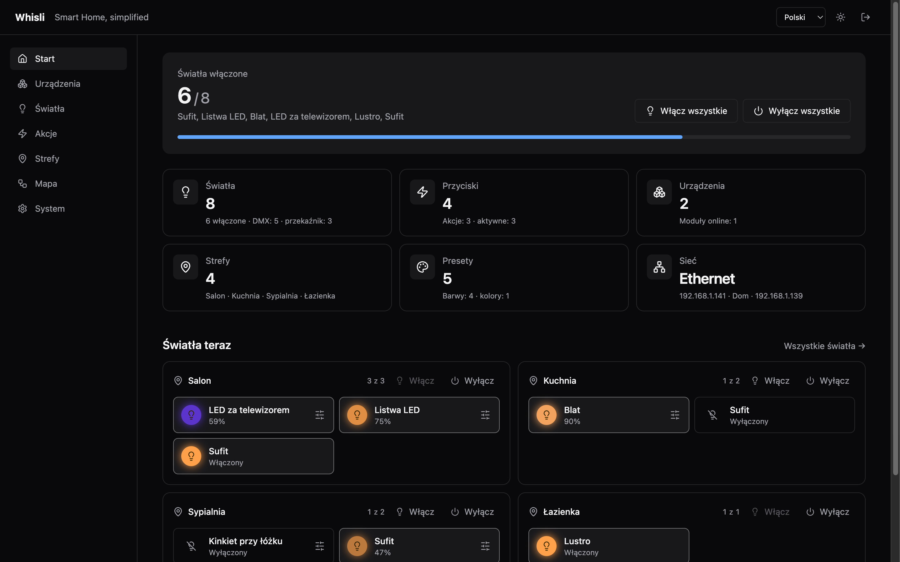
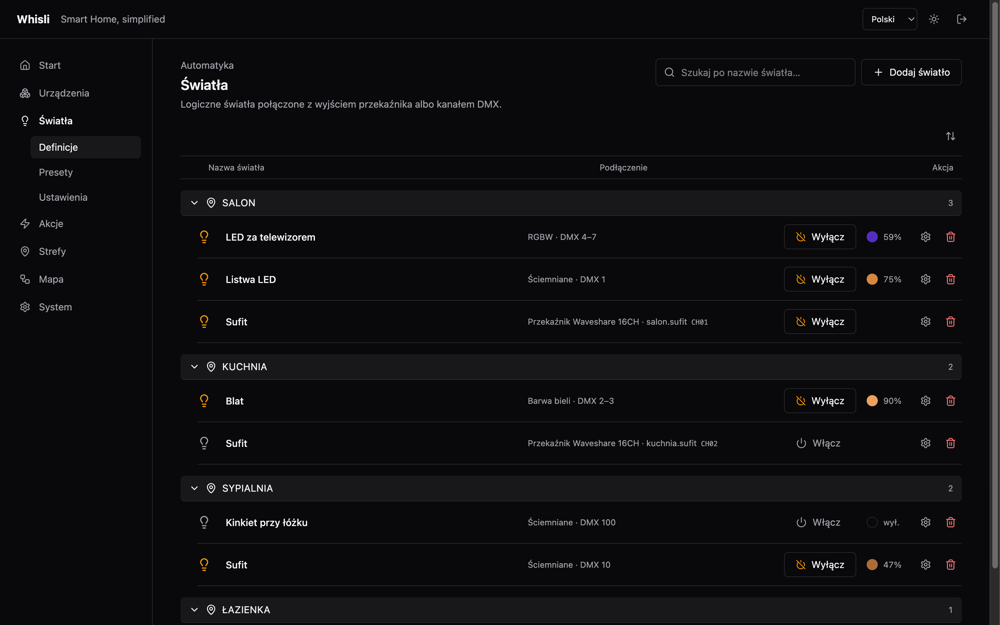
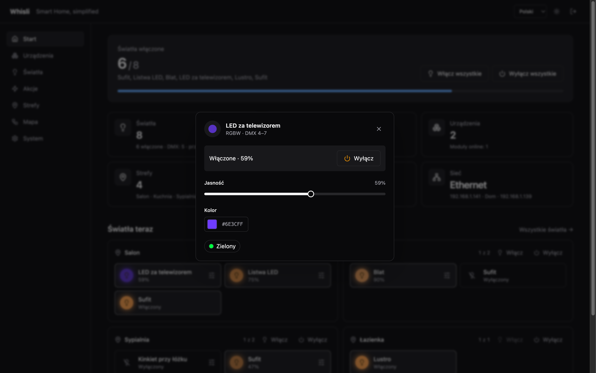
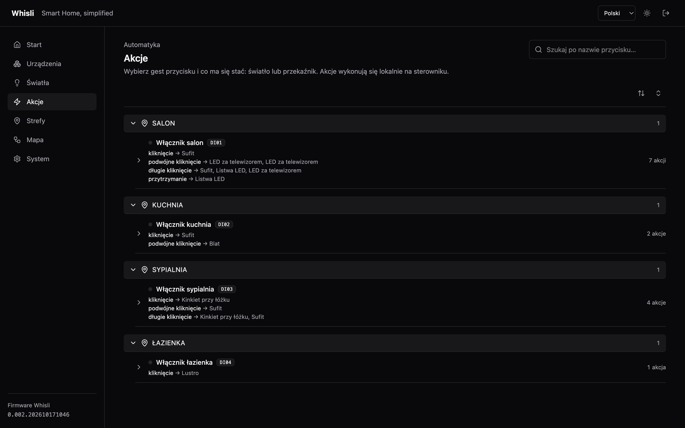
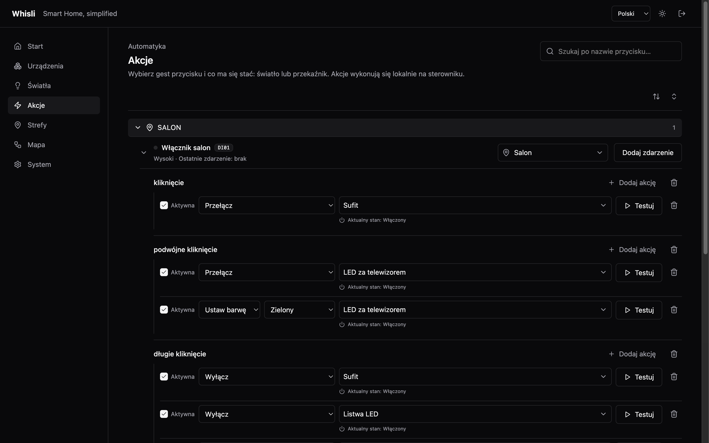
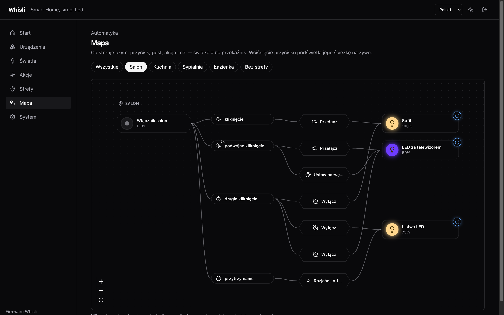
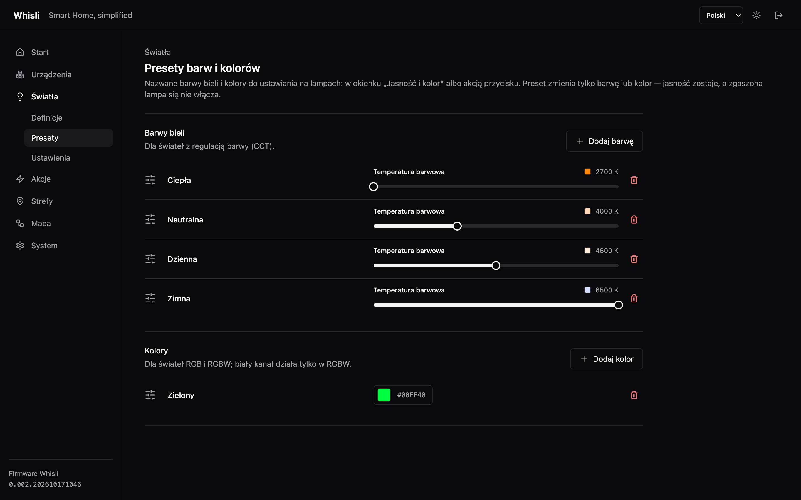
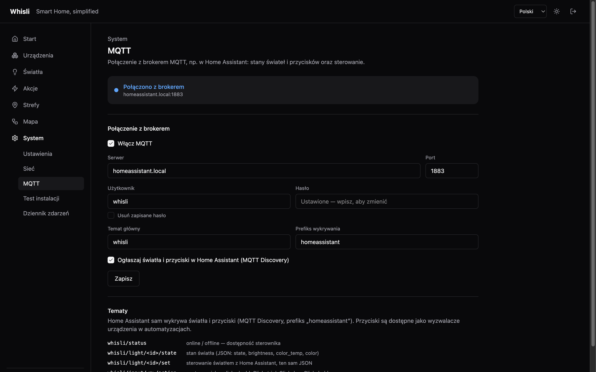
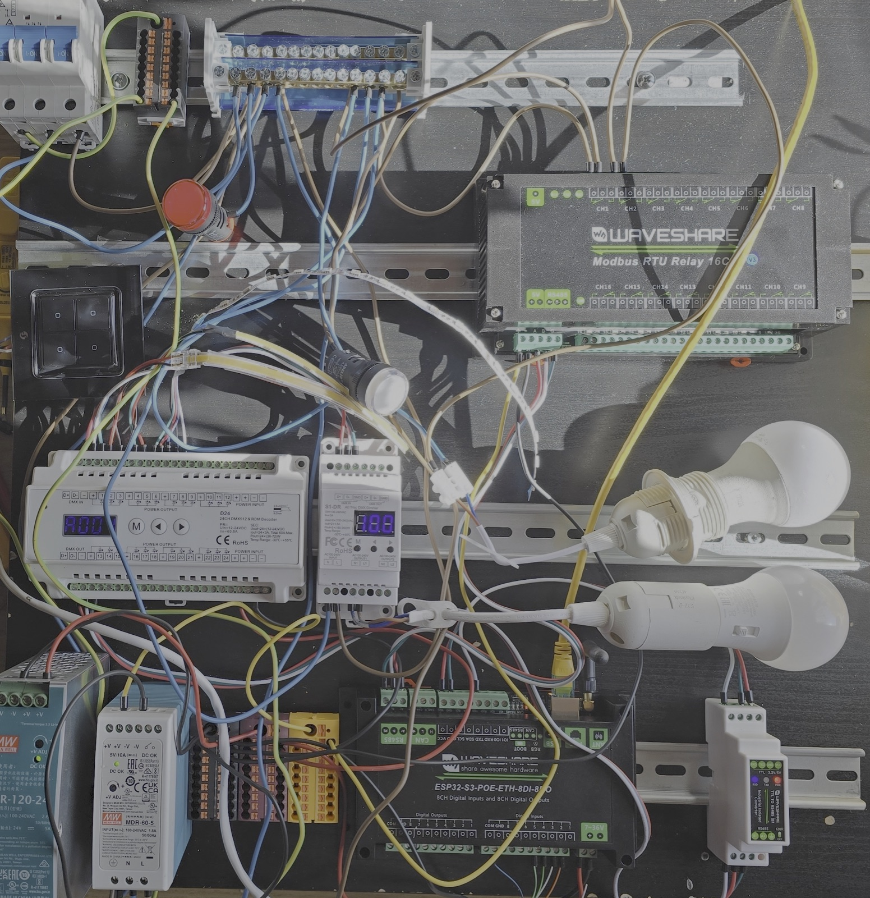

# Whisli

**Whisli** to autonomiczny sterownik oświetlenia domowego oparty na ESP32, Modbus RTU, DMX512 i MQTT.

Projekt jest przeznaczony przede wszystkim do instalacji elektrycznych w topologii gwiazdy, w których obwody oświetleniowe i przewody od przycisków trafiają do centralnej rozdzielnicy.

Sterownik obsługuje wejścia cyfrowe, przekaźniki, ściemniacze DMX, logikę przycisków i komunikację z Home Assistantem. Konfiguracja i diagnostyka są dostępne przez wbudowany interfejs WWW.

**Podstawowe sterowanie oświetleniem działa lokalnie — bez Home Assistanta, internetu i usług chmurowych.**

Projekt jest rozwijany jako open source.



## Skąd pomysł?

Na co dzień korzystam z Home Assistanta. To świetne narzędzie do automatyki domowej, ale od dłuższego czasu przeszkadzało mi rozproszone sterowanie oświetleniem.

Shelly w jednej puszce, przekaźnik Zigbee w drugiej, osobny sterownik LED, kolejne integracje, konfiguracje i aktualizacje firmware. Wszystko działa, ale przy większej liczbie punktów świetlnych powstaje spory zbiór niezależnych urządzeń.

Niedawno trafiła mi się instalacja elektryczna, którą można stosunkowo łatwo przerobić na topologię gwiazdy. To dobra okazja, żeby spróbować centralnego sterowania oświetleniem.

Założenia były następujące:

- Jeden sterownik zarządzający oświetleniem całego domu.
- Zwykłe przyciski monostabilne zamiast inteligentnych włączników.
- Obsługa ON/OFF, ściemniania, CCT i RGB/RGBW.
- Konfigurowalne zdarzenia przycisków i przypisane do nich akcje.
- Autonomiczne działanie, niezależne od Home Assistanta.
- Dwukierunkowa integracja z HA przez MQTT.
- Konfiguracja przez przeglądarkę, bez modyfikowania firmware.
- Wykorzystanie ogólnodostępnych modułów.

Nie chciałem pisać alternatywy dla Home Assistanta. Chodziło o wydzielenie podstawowej obsługi oświetlenia do osobnego urządzenia.

## Dlaczego własny sterownik?

Na rynku jest sporo gotowych rozwiązań: PLC, KNX, moduły przekaźnikowe i dedykowane sterowniki automatyki budynkowej.

Zrobiłem niewielkie rozpoznanie dostępnych urządzeń. Ponieważ lubię programować i eksperymentować z elektroniką, postanowiłem sprawdzić, ile da się uzyskać z ogólnodostępnych modułów, bez projektowania własnej elektroniki.

| Technologia | Zastosowanie |
|---|---|
| ESP32-S3 | Główny sterownik |
| Modbus RTU / RS485 | Moduły wejściowe i przekaźnikowe |
| DMX512 | Sterowanie jasnością i barwą oświetlenia |
| MQTT | Dwukierunkowa komunikacja z Home Assistantem |
| Ethernet / PoE | Komunikacja sieciowa i zasilanie sterownika |
| Web UI | Konfiguracja i diagnostyka |

Wybór DMX512 wynikał z dostępności wielokanałowych sterowników LED i ściemniaczy TRIAC obsługujących ten protokół.

Nie twierdzę, że jest to rozwiązanie lepsze od KNX. Po prostu odpowiada wymaganiom tej instalacji.

## Jak to działa

Pierwotnie planowałem niewielki firmware obsługujący wejścia, przekaźniki i kilka podstawowych akcji. Projekt trochę się rozrósł — większość funkcji z pierwotnego zakresu jest już zaimplementowana.

Podstawą jest **logiczny punkt świetlny**: ma nazwę, typ (ON/OFF, DIM, CCT, RGB, RGBW), strefę i powiązanie z fizycznym wyjściem — przekaźnikiem albo kanałami DMX. Akcje operują na światłach, a nie na numerach przekaźników czy adresach DMX, więc zmiana podłączenia nie wymaga przebudowy konfiguracji przycisków.

| | |
|---|---|
|  |  |

Zwykły przycisk monostabilny nie jest przypisany na stałe do obwodu. Generuje zdarzenia — kliknięcie, podwójne, długie, przytrzymanie — a do każdego można przypisać kilka akcji: włącz, wyłącz, przełącz, ustaw jasność, rozjaśniaj / ściemniaj, ustaw barwę lub kolor. Wszystko konfiguruje się przez WWW, a akcje wykonują się lokalnie na ESP32.

| | |
|---|---|
|  |  |

Mapa pokazuje całą ścieżkę **przycisk → zdarzenie → akcja → światło** i podświetla ją na żywo przy fizycznym naciśnięciu, co ułatwia diagnostykę. Nazwane presety barw i kolorów działają w ręcznym sterowaniu i w akcjach. Nie jest to mechanizm scen — sceny i rozbudowane automatyzacje pozostają po stronie Home Assistanta.

| | |
|---|---|
|  |  |

## Home Assistant i MQTT

Whisli komunikuje się z Home Assistantem przez MQTT z obsługą **MQTT Discovery** — światła i przyciski pojawiają się w HA same. Sterownik publikuje swoją dostępność i stany świateł (z jasnością, barwą i kolorem), przyjmuje polecenia z HA i udostępnia zdarzenia przycisków automatyzacjom.



**Whisli:** fizyczne wejścia i wyjścia, obsługa przycisków, sterowanie światłami, lokalne akcje, konfiguracja i komunikacja z HA.

**Home Assistant:** sceny, harmonogramy, czujniki obecności, automatyzacje zależne od innych urządzeń i integracje z pozostałymi systemami.

Awaria Home Assistanta lub brokera MQTT nie blokuje lokalnego sterowania oświetleniem. Sam ESP32 pozostaje pojedynczym punktem awarii.

## Sprzęt

Na obecnym etapie wykorzystuję gotowe moduły. Nie projektowałem własnego PCB.

| Element | Zastosowanie |
|---|---|
| Waveshare ESP32-S3 PoE ETH 8DI/8DO | Sterownik główny |
| Waveshare Modbus RTU 16CH Relay | Sterowanie obwodami ON/OFF |
| Moduł wejść cyfrowych RS485 | Dodatkowe wejścia dla przycisków |
| DMX512 D24 24CH | Sterowanie taśmami LED |
| DMX512 S1-DR 2CH | Ściemnianie kompatybilnego oświetlenia 230 V |
| Konwerter TTL ↔ RS485 | Interfejs magistrali |
| Zasilacze 5 V / 24 V | Zasilanie elektroniki i LED |

Konstrukcja pozwala rozbudowywać liczbę wejść i wyjść przez dodatkowe moduły. Konkretne limity zależą od konfiguracji magistral, firmware i użytego sprzętu.

## Laboratorium



Tak wygląda obecne stanowisko testowe. Cable management na razie nie jest częścią projektu. ;)

Na tym zestawie testuję komunikację z urządzeniami, sterowanie oświetleniem i kolejne wersje firmware. Firmware jest napisany w **C++ z wykorzystaniem PlatformIO** i działa na ESP32-S3. Interfejs WWW jest udostępniany bezpośrednio przez sterownik. Konfiguracja jest przechowywana lokalnie; system nie wymaga zewnętrznej bazy danych ani serwera aplikacyjnego.

## Co dalej?

Większość pierwotnych założeń funkcjonalnych jest już zrealizowana. Następny etap to przede wszystkim testy i przygotowanie do pracy w rzeczywistej instalacji:

- Długoterminowe testy stabilności.
- Testy komunikacji z większą liczbą modułów.
- Obsługa błędów i sytuacji awaryjnych.
- Dopracowanie diagnostyki.
- Testy zachowania po zaniku i powrocie zasilania.
- Optymalizacja firmware i wykorzystania pamięci.
- Dokumentacja podłączenia modułów.
- Uproszczenie pierwszego uruchomienia.

Nie planuję budować uniwersalnej platformy automatyki domowej. Zakres Whisli ma pozostać ograniczony do **wejść, świateł, akcji, komunikacji i konfiguracji**.

## Po co publikuję?

Projekt powstał na potrzeby mojej instalacji, ale może przydać się również osobom, które mają instalację w topologii gwiazdy albo planują jej wykonanie i nie chcą zaczynać od pisania własnego firmware.

Docelowy proces uruchomienia — bez znajomości C++:

1. Wgrać firmware na ESP32.
2. Podłączyć obsługiwane moduły.
3. Skonfigurować urządzenia przez przeglądarkę.
4. Zdefiniować światła.
5. Przypisać akcje do przycisków.
6. Opcjonalnie skonfigurować MQTT.

> [!WARNING]
> Projekt jest nadal rozwijany i nie przeszedł jeszcze długoterminowych testów w docelowej instalacji. Nie jest certyfikowanym systemem automatyki budynkowej. Prace przy obwodach 230 V powinny być wykonywane przez osoby z odpowiednimi kwalifikacjami, z zachowaniem wymaganych zabezpieczeń i przepisów.

Kod udostępniam do testów, wykorzystania we własnych projektach i ewentualnej rozbudowy.

## Szybki start

Gotowy firmware jest w [wydaniach na GitHubie](https://github.com/tjaworski997/whisli/releases/latest) — nie trzeba niczego kompilować. Każde wydanie ma dwa pliki:

| Plik | Do czego |
|---|---|
| [`firmware-full.bin`](https://github.com/tjaworski997/whisli/releases/latest/download/firmware-full.bin) | Pierwsze wgranie przez USB na czystą płytkę |
| [`firmware.bin`](https://github.com/tjaworski997/whisli/releases/latest/download/firmware.bin) | Aktualizacja działającego sterownika przez panel |

### 1. Wgranie firmware

1. Podłącz płytkę Waveshare ESP32-S3-POE-ETH-8DI-8DO kablem USB-C, **trzymając przycisk BOOT** — płytka wejdzie w tryb wgrywania.
2. W Chrome lub Edge otwórz [ESP Tool](https://espressif.github.io/esptool-js/), kliknij **Connect** i wybierz port płytki.
3. W polu **Flash Address** zostaw `0x0`, wybierz plik `firmware-full.bin` i kliknij **Program**.
4. Po zakończeniu odłącz i podłącz zasilanie.

Z wiersza poleceń to samo robi [esptool](https://docs.espressif.com/projects/esptool/):

```sh
esptool.py --chip esp32s3 write_flash 0x0 firmware-full.bin
```

### 2. Pierwsze połączenie

- **Ethernet:** podłącz kabel — sterownik dostanie adres z DHCP (sprawdzisz go w routerze). Płytkę można też zasilić przez PoE.
- **Wi-Fi:** połącz się z siecią **`Whisli-Setup`**, hasło **`whisli_gogo`**, i otwórz `http://192.168.4.1/`. Stąd podłączysz sterownik do domowego Wi-Fi.

### 3. Logowanie

| | |
|---|---|
| Hasło panelu | `whisli_gogo` |
| Hasło sieci `Whisli-Setup` | `whisli_gogo` |

Zmień oba od razu: hasło panelu w **System → Ustawienia**, punkt dostępowy w **System → Sieć** (tam można go też wyłączyć — wróci sam, jeśli sterownik przez minutę nie będzie miał żadnej sieci).

**Zapomniane hasło panelu:** przytrzymaj przycisk BOOT na działającym sterowniku przez 10 sekund. Wraca hasło `whisli_gogo`, konfiguracja zostaje.

### 4. Konfiguracja

W panelu: **Urządzenia** (moduły przekaźników, DMX) → **Światła** → **Strefy** → **Akcje** dla przycisków. Połączenie z Home Assistantem: **System → MQTT**.

Kolejne wersje wgrywa się już bez USB: **System → Ustawienia → Aktualizacja firmware**, plik `firmware.bin`.

---

# Dokumentacja techniczna

Lokalny sterownik oświetlenia i automatyki domu na płytce Waveshare
ESP32-S3-POE-ETH-8DI-8DO. Przyciski ścienne sterują światłami i przekaźnikami
bezpośrednio na sterowniku — bez Internetu, chmury i Home Assistanta. Panel WWW
służy do konfiguracji i podglądu, a jego zmiany widać na żywo.

Co obsługuje dziś:

- **Wejścia** — 8 wbudowanych DI z rozpoznawaniem gestów (klik, podwójny, potrójny,
  długi, przytrzymanie).
- **Akcje** — gest przycisku → włącz / wyłącz / przełącz, ustaw jasność, rozjaśnij /
  ściemnij o n %, ustaw preset barwy lub koloru; cel: światło albo przekaźnik.
- **Strefy i presety** — grupowanie świateł i przycisków w pomieszczenia; nazwane
  barwy bieli i kolory.
- **MQTT / Home Assistant** — stany i sterowanie świateł, gesty przycisków jako
  wyzwalacze, MQTT Discovery (tematy w **System → MQTT**).
- **Światła** — przełączane (przekaźnik), ściemniane (DMX, 1 kanał), barwa bieli
  CCT (2 kanały), kolor RGB (3) i RGBW (4). Dla każdego światła DMX: krzywa
  ściemniania i jasność minimalna.
- **Urządzenia** — 8 wbudowanych wyjść DO oraz do 8 modułów przekaźników
  Modbus RTU (Waveshare 16CH / 32CH lub profil własny).
- **DMX512** — jedno uniwersum na UART0 (GPIO43) dla dekoderów LED i ściemniaczy
  230 V (np. S1-DR).
- **Panel** — React, polski i angielski, jasny i ciemny motyw, aktualizacje na
  żywo przez WebSocket, dziennik zdarzeń, aktualizacja firmware przez przeglądarkę.

Najważniejsza zasada: **przyciski i światła mają absolutny priorytet**; panel, API,
OTA i integracje zawsze im ustępują.

### Układ kodu

```text
src/main.cpp          składanie modułów; loop() tylko dla zadań w tle
src/bootstrap/        sieć (Ethernet, Wi-Fi, punkt dostępowy), /setup, OTA
src/net/              serwer HTTP (esp_http_server), logowanie, WebSocket
src/app/              wejścia, akcje, światła, DMX, Modbus, API aplikacji
src/system/           dziennik zdarzeń, blokada stanu
include/whisli/       interfejsy; system/task_priorities.hpp — kolejność zadań
data/                 katalog profili urządzeń (źródło dla generatora C++)
ui/                   panel React (shadcn/ui, Base UI, Tailwind, Lucide)
doc/                  dokumentacja sprzętu, zrzuty ekranu
```

### Budowanie

```sh
./scripts/build_firmware.sh
```

Skrypt nadaje wersję `0.002.RRRRMMDDGGMM`, buduje panel React, kompresuje go i
osadza w firmware, a następnie kompiluje obraz. Wynik w `_build/`:

- `firmware.bin` — kod sterownika z panelem (nie ma osobnego systemu plików);
  do aktualizacji przez panel lub API,
- `firmware-full.bin` — to samo z bootloaderem i tablicą partycji, do pierwszego
  wgrania przez USB od adresu `0x0`.

Panel można rozwijać lokalnie na żywym sterowniku (proxy `/api` z WebSocketem):

```sh
cd ui && npm install
WHISLI_DEVICE_URL=http://192.168.128.141 ./run_react.sh
```

### Pierwsze uruchomienie

Z gotowego wydania — patrz [Szybki start](#szybki-start). Ze źródeł:

1. Wgraj obraz przez USB: `./scripts/build_firmware.sh -t upload`
   (płytka w trybie pobierania: przytrzymaj BOOT przy podłączaniu USB).
2. Po kablu sterownik dostaje adres z DHCP. Bez kabla połącz się z Wi-Fi
   `Whisli-Setup` (hasło `whisli_gogo`) i otwórz `http://192.168.4.1/`.
3. Zaloguj się do panelu hasłem `whisli_gogo` i od razu ustaw własne
   (**System → Ustawienia**). Wi-Fi i punkt dostępowy: **System → Sieć**.

Punkt `Whisli-Setup` jest domyślnie włączony. Można go wyłączyć; wraca sam, gdy
sterownik przez minutę nie ma Ethernetu ani Wi-Fi, żeby dało się odzyskać dostęp.

### Aktualizacje

Panel → **System → Ustawienia** → wybierz `_build/firmware.bin` → **Wgraj firmware**. Panel
odczytuje wersję z pliku, wysyła go (ok. 10 s), czeka na restart i uznaje
aktualizację za udaną dopiero, gdy sterownik zgłosi wersję z pliku. Przy błędzie
przyczyna jest w dzienniku zdarzeń (kategoria „firmware”).

Z wiersza poleceń:

```sh
curl -u whisli:<hasło> -H "Content-Type: application/octet-stream" \
  --data-binary @_build/firmware.bin http://<adres>/api/v1/firmware
```

### Kopia konfiguracji

**System → Kopia konfiguracji:** „Pobierz kopię” zapisuje urządzenia, wejścia,
światła, akcje i strefy do pliku JSON; „Wczytaj z pliku” zastępuje nimi obecną
konfigurację i restartuje sterownik. Ustawienia sieci i MQTT trafiają do pliku bez
haseł; hasła Wi-Fi i MQTT tylko w bloku zaszyfrowanym hasłem kopii (AES-256-GCM).
Hasło panelu nie trafia do pliku nigdy.

```sh
curl -u whisli:<hasło> http://<adres>/api/v1/config/backup -o whisli_config.json
curl -u whisli:<hasło> -H "Content-Type: application/json" \
  --data-binary @whisli_config.json http://<adres>/api/v1/config/restore
```

### Logowanie

Jeden użytkownik, samo hasło (domyślne `whisli_gogo`). Panel ma własny ekran
logowania z opcją „Zapamiętaj mnie na 30 dni”, wylogowanie w nagłówku, a zmianę
hasła w **System → Hasło dostępu**. Skrypty i `curl` logują się przez HTTP Basic
z dowolną nazwą użytkownika i tym samym hasłem.

- Hasło jest zapisane w sterowniku jako skrót PBKDF2 z solą.
- Błędne hasła trafiają do dziennika zdarzeń.
- **Zapomniane hasło:** przytrzymaj przycisk BOOT na działającym sterowniku przez
  10 s. Wraca hasło domyślne i wszystkie sesje są kończone; konfiguracja zostaje.
- Panel działa po zwykłym HTTP, więc dostęp spoza domu tylko przez VPN, nigdy
  przez przekierowanie portu.

W trybie dev (`ui/run_react.sh`) panel loguje się normalnie przez proxy.
`WHISLI_DEVICE_AUTH="whisli:<hasło>"` sprawia, że proxy loguje każde zapytanie
samo i ekran logowania się nie pokazuje.

---

**Whisli – Smart Home, simplified**
*ESP32 · Modbus RTU · DMX512 · MQTT · Home Assistant*
