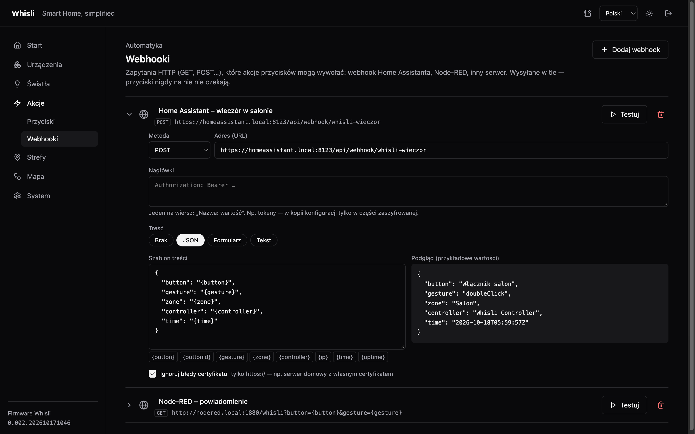

<div align="right"><a href="README.pl.md">Polski</a> · <b>English</b></div>

# Whisli

**Whisli** is a standalone home lighting controller built on ESP32, Modbus RTU, DMX512 and MQTT.

It is meant mainly for electrical installations in a star topology, where the lighting circuits and the wires from the wall buttons all run to a central distribution board.

The controller handles digital inputs, relays, DMX dimmers, button logic and communication with Home Assistant. Configuration and diagnostics are available in the built-in web interface.

**Basic lighting control works locally — without Home Assistant, the internet or cloud services.**

The project is developed as open source.

> The screenshots show the Polish version of the panel; it is available in English as well.


## Where the idea came from

I use Home Assistant every day. It is a great home automation tool, but for a long time the scattered lighting control bothered me.

A Shelly in one wall box, a Zigbee relay in another, a separate LED controller, more integrations, configurations and firmware updates. It all works, but with many light points you end up with a large collection of independent devices.

Recently I got an electrical installation that can be converted to a star topology fairly easily. A good chance to try central lighting control.

The goals were:

- One controller managing the lighting of the whole house.
- Ordinary momentary push buttons instead of smart switches.
- ON/OFF, dimming, CCT and RGB/RGBW.
- Configurable button events with actions assigned to them.
- Standalone operation, independent of Home Assistant.
- Two-way integration with HA over MQTT.
- Configuration in the browser, without changing the firmware.
- Widely available modules.

I did not want to write an alternative to Home Assistant. The point was to move basic lighting control into a separate device.

## Why my own controller?

There are plenty of ready-made solutions: PLCs, KNX, relay modules and dedicated building automation controllers.

I looked around a little. Since I enjoy programming and experimenting with electronics, I decided to see how far widely available modules can go, without designing my own electronics.

| Technology | Used for |
|---|---|
| ESP32-S3 | Main controller |
| Modbus RTU / RS485 | Input and relay modules |
| DMX512 | Brightness and colour control |
| MQTT | Two-way communication with Home Assistant |
| Ethernet / PoE | Networking and powering the controller |
| Web UI | Configuration and diagnostics |

DMX512 was chosen because multi-channel LED controllers and TRIAC dimmers with this protocol are easy to get.

I do not claim it is better than KNX. It simply meets the needs of this installation.

## How it works

At first I planned a small firmware handling inputs, relays and a few basic actions. The project grew a bit — most of the features from the original scope are already implemented.

The core is a **logical light**: it has a name, a type (ON/OFF, DIM, CCT, RGB, RGBW), a zone and a link to a physical output — a relay or DMX channels. Actions work on lights, not on relay numbers or DMX addresses, so rewiring does not require rebuilding the button configuration.

| | |
|---|---|
|  |  |

An ordinary momentary button is not tied to a circuit. It produces events — click, double click, long press, hold — and each can have several actions: on, off, toggle, set brightness, brighten / dim, set the white tone or colour. Everything is configured in the browser, and the actions run locally on the ESP32.

| | |
|---|---|
|  |  |

An action can also call a **webhook** — an HTTP request to Home Assistant, Node-RED or any server. The body is a template with variables (which button, which gesture, zone, time), and a preview shows right away what will be sent. Requests go out in the background, so a slow or unreachable server never delays the buttons.



The map shows the whole path **button → event → action → light** and lights it up live when a physical button is pressed, which makes troubleshooting easier. Named white tone and colour presets work in manual control and in actions. This is not a scene mechanism — scenes and complex automations stay in Home Assistant.

| | |
|---|---|
|  |  |

## Home Assistant and MQTT

Whisli talks to Home Assistant over MQTT with **MQTT Discovery** — lights and buttons appear in HA by themselves, as one device with a name of your choice. The controller publishes its availability and the light states (with brightness, white tone and colour) and takes commands from HA. Each button is an "event" entity with the last gesture and its history, and its gestures are also device triggers for automations.

The broker connection can be checked with **Test connection** before saving the settings. After the base topic or the broker changes, the controller removes its old messages, so no leftovers stay on the broker.


**Whisli:** physical inputs and outputs, button handling, light control, local actions, configuration and communication with HA.

**Home Assistant:** scenes, schedules, presence sensors, automations that depend on other devices and integrations with other systems.

A Home Assistant or MQTT broker failure does not block local lighting control. The ESP32 itself remains a single point of failure.

## Hardware

At this stage I use ready-made modules. I have not designed my own PCB.

| Part | Used for |
|---|---|
| Waveshare ESP32-S3 PoE ETH 8DI/8DO | Main controller |
| Waveshare Modbus RTU 16CH Relay | Switching ON/OFF circuits |
| RS485 digital input module | Extra inputs for buttons |
| DMX512 D24 24CH | Driving LED strips |
| DMX512 S1-DR 2CH | Dimming compatible 230 V lighting |
| TTL ↔ RS485 converter | Bus interface |
| 5 V / 24 V power supplies | Powering the electronics and LEDs |

The design allows adding inputs and outputs with extra modules. The actual limits depend on the bus configuration, the firmware and the hardware used.

## The lab


This is the current test bench. Cable management is not part of the project yet. ;)

On this setup I test communication with the devices, lighting control and new firmware versions. The firmware is written in **C++ with PlatformIO** and runs on the ESP32-S3. The web interface is served directly by the controller. The configuration is stored locally; the system needs no external database or application server.

## What next?

Most of the original functional goals are done. The next stage is mainly testing and preparing for a real installation:

- Long-term stability tests.
- Tests with more modules on the bus.
- Error handling and failure situations.
- Better diagnostics.
- Behaviour after a power cut and when power comes back.
- Firmware and memory optimisation.
- Documentation for wiring the modules.
- A simpler first setup.

I do not plan to build a general home automation platform. Whisli's scope is to stay limited to **inputs, lights, actions, communication and configuration**.

## Why publish it?

The project was made for my own installation, but it may also help people who have a star-topology installation, or plan one, and do not want to start by writing their own firmware.

The intended setup — without knowing C++:

1. Flash the firmware to the ESP32.
2. Connect the supported modules.
3. Configure the devices in the browser.
4. Define the lights.
5. Assign actions to the buttons.
6. Optionally set up MQTT.

> [!WARNING]
> The project is still in development and has not yet been tested long-term in its target installation. It is not a certified building automation system. Work on 230 V circuits should be done by qualified people, with the required protection and in line with the regulations.

I share the code for testing, for use in your own projects and for further development.

## Quick start

Ready firmware is in the [GitHub releases](https://github.com/tjaworski997/whisli/releases/latest) — no need to compile anything. Each release has two files:

| File | For |
|---|---|
| [`firmware-full.bin`](https://github.com/tjaworski997/whisli/releases/latest/download/firmware-full.bin) | First flash over USB to a blank board |
| [`firmware.bin`](https://github.com/tjaworski997/whisli/releases/latest/download/firmware.bin) | Updating a running controller from the panel |

### 1. Flashing the firmware

1. Connect the Waveshare ESP32-S3-POE-ETH-8DI-8DO board with a USB-C cable **while holding the BOOT button** — the board enters flashing mode.
2. In Chrome or Edge open [ESP Tool](https://espressif.github.io/esptool-js/), click **Connect** and choose the board's port.
3. Leave **Flash Address** at `0x0`, choose `firmware-full.bin` and click **Program**.
4. When it finishes, unplug and reconnect the power.

From the command line, [esptool](https://docs.espressif.com/projects/esptool/) does the same:

```sh
esptool.py --chip esp32s3 write_flash 0x0 firmware-full.bin
```

### 2. First connection

- **Ethernet:** plug in the cable — the controller gets an address from DHCP (check it in your router). The board can also be powered over PoE.
- **Wi-Fi:** join the **`Whisli-Setup`** network, password **`whisli_gogo`**, and open `http://192.168.4.1/`. From there you can connect the controller to your home Wi-Fi.

### 3. Signing in

| | |
|---|---|
| Panel password | `whisli_gogo` |
| `Whisli-Setup` network password | `whisli_gogo` |

Change both right away: the panel password in **System → Settings**, the access point in **System → Network** (it can also be turned off there — it comes back by itself if the controller has no network for a minute).

**Forgotten panel password:** hold the BOOT button on the running controller for 10 seconds. The password goes back to `whisli_gogo`; the configuration stays.

### 4. Configuration

In the panel: **Devices** (relay modules, DMX) → **Lights** → **Zones** → **Actions** for the buttons. Connection to Home Assistant: **System → MQTT**.

Later versions are installed without USB: **System → Settings → Firmware update**, file `firmware.bin`.

---

# Technical documentation

A local lighting and home automation controller on the Waveshare
ESP32-S3-POE-ETH-8DI-8DO board. Wall buttons control lights and relays
directly on the controller — without the internet, the cloud or Home Assistant. The web panel
is for configuration and monitoring, and its changes show live.

What it supports today:

- **Inputs** — 8 built-in DIs with gesture recognition (click, double, triple,
  long, hold).
- **Actions** — button gesture → on / off / toggle, set brightness, brighten /
  dim by n %, set a white tone or colour preset, call a webhook; target: a light,
  a relay or a webhook.
- **Zones and presets** — grouping lights and buttons into rooms; named
  white tones and colours.
- **MQTT / Home Assistant** — MQTT Discovery: lights (state and control), buttons
  as event entities and device triggers; settable device name in HA,
  broker connection test, cleanup of old topics after the settings change
  (**System → MQTT**).
- **Lights** — switched (relay), dimmed (DMX, 1 channel), CCT white tone
  (2 channels), RGB colour (3) and RGBW (4). For each DMX light: dimming curve
  and minimum brightness.
- **Webhooks** — HTTP/HTTPS requests (GET, POST, PUT, DELETE) called from button
  actions: body template (JSON, form, text) with the variables `{button}`,
  `{gesture}`, `{zone}`, `{time}`…, headers with tokens, an option to ignore
  certificate errors. Sent in the background with a 5 s limit — buttons never wait for them.
- **Notes** — plain text about the installation (hardware, wiring, addresses), saved
  as you type and included in the configuration backup.
- **Devices** — 8 built-in DO outputs and up to 16 Modbus RTU relay modules
  (Waveshare 16CH / 32CH or a custom profile).
- **DMX512** — one universe on UART0 (GPIO43) for LED decoders and 230 V dimmers
  (e.g. S1-DR).
- **Panel** — React, Polish and English, light and dark theme, live updates
  over WebSocket, event log, firmware update from the browser.

The most important rule: **buttons and lights have absolute priority**; the panel, API,
OTA and integrations always give way to them.

### Code layout

```text
src/main.cpp          puts the modules together; loop() only for background jobs
src/bootstrap/        network (Ethernet, Wi-Fi, access point), /setup, OTA
src/net/              HTTP server (esp_http_server), sign-in, WebSocket
src/app/              inputs, actions, lights, DMX, Modbus, MQTT, webhooks, application API
src/system/           configuration in files (LittleFS), configuration backup, notes,
                      event log, state lock
include/whisli/       interfaces; system/task_priorities.hpp — task order
data/                 device profile catalogue (source for the C++ generator)
ui/                   React panel (shadcn/ui, Base UI, Tailwind, Lucide)
doc/                  hardware documentation, screenshots
```

### Building

```sh
./scripts/build_firmware.sh
```

The script stamps the version `0.002.YYYYMMDDHHMM`, builds the React panel, compresses it,
embeds it in the firmware and compiles the image. Output in `_build/`:

- `firmware.bin` — the controller code with the panel (there is no separate file system image);
  for updates from the panel or the API,
- `firmware-full.bin` — the same with the bootloader and partition table, for the first
  flash over USB at address `0x0`.

The panel can be developed locally against a live controller (`/api` proxy with WebSocket):

```sh
cd ui && npm install
WHISLI_DEVICE_URL=http://192.168.128.141 ./run_react.sh
```

### First start

From a ready release — see [Quick start](#quick-start). From source:

1. Flash the image over USB: `./scripts/build_firmware.sh -t upload`
   (board in download mode: hold BOOT while plugging in USB).
2. On a cable the controller gets an address from DHCP. Without a cable join the
   `Whisli-Setup` Wi-Fi (password `whisli_gogo`) and open `http://192.168.4.1/`.
3. Sign in to the panel with `whisli_gogo` and set your own password right away
   (**System → Settings**). Wi-Fi and the access point: **System → Network**.

The `Whisli-Setup` access point is on by default. It can be turned off; it comes back by itself when
the controller has neither Ethernet nor Wi-Fi for a minute, so access can always be recovered.

### Updates

Panel → **System → Settings** → choose `_build/firmware.bin` → **Upload firmware**. The panel
reads the version from the file, sends it (about 10 s), waits for the restart and counts the
update as successful only when the controller reports the version from the file. On an error
the reason is in the event log (category "firmware").

From the command line:

```sh
curl -u whisli:<password> -H "Content-Type: application/octet-stream" \
  --data-binary @_build/firmware.bin http://<address>/api/v1/firmware
```

### Configuration backup

**System → Configuration backup:** "Download backup" saves devices, inputs,
lights, actions and zones to a JSON file; "Load from file" replaces the current
configuration with them and restarts the controller. Presets, webhooks and notes are included too.
Network and MQTT settings go into the file without passwords; Wi-Fi and MQTT passwords and
webhook headers (tokens) only in a block encrypted with the backup password (AES-256-GCM).
The panel password never goes into the file.

```sh
curl -u whisli:<password> http://<address>/api/v1/config/backup -o whisli_config.json
curl -u whisli:<password> -H "Content-Type: application/json" \
  --data-binary @whisli_config.json http://<address>/api/v1/config/restore
```

### Sign-in

One user, password only (default `whisli_gogo`). The panel has its own sign-in
screen with "Remember me for 30 days", sign-out in the header, and the password
change in **System → Settings** (Password). Scripts and `curl` sign in with HTTP Basic
with any user name and the same password.

- The password is stored on the controller as a salted PBKDF2 hash.
- Wrong passwords are written to the event log.
- **Forgotten password:** hold the BOOT button on the running controller for
  10 s. The default password comes back and all sessions end; the configuration stays.
- The panel runs over plain HTTP, so access from outside the home only through a VPN, never
  through port forwarding.

In dev mode (`ui/run_react.sh`) the panel signs in normally through the proxy.
`WHISLI_DEVICE_AUTH="whisli:<password>"` makes the proxy sign in every request
itself, and the sign-in screen does not show.

---

**Whisli – Smart Home, simplified**
*ESP32 · Modbus RTU · DMX512 · MQTT · Home Assistant*
